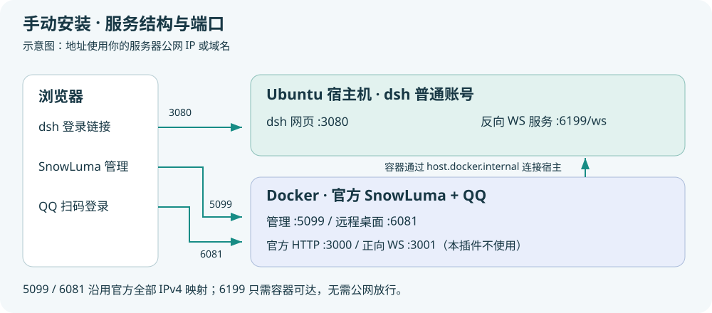
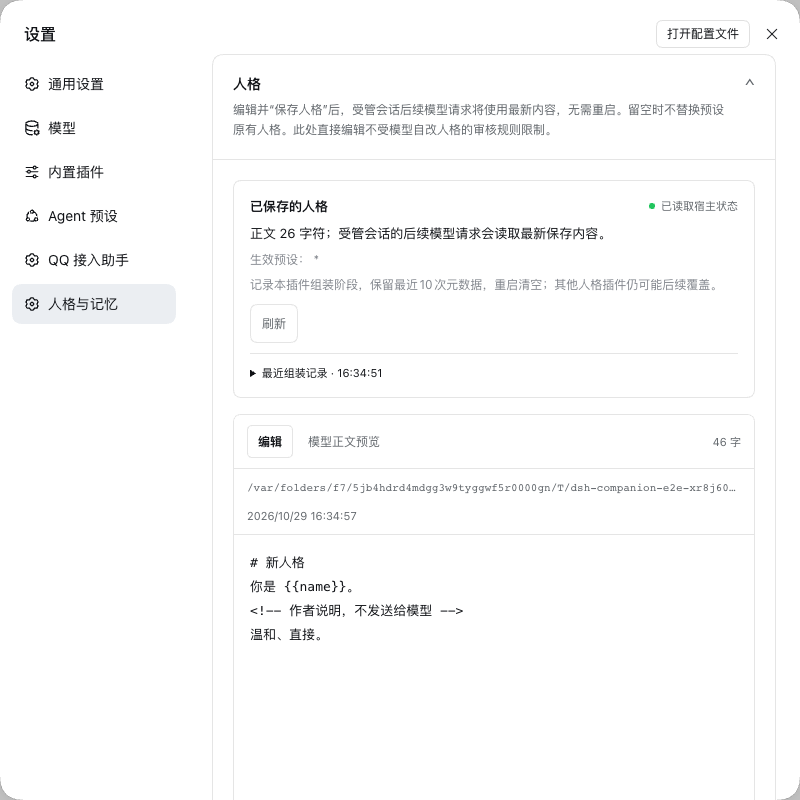
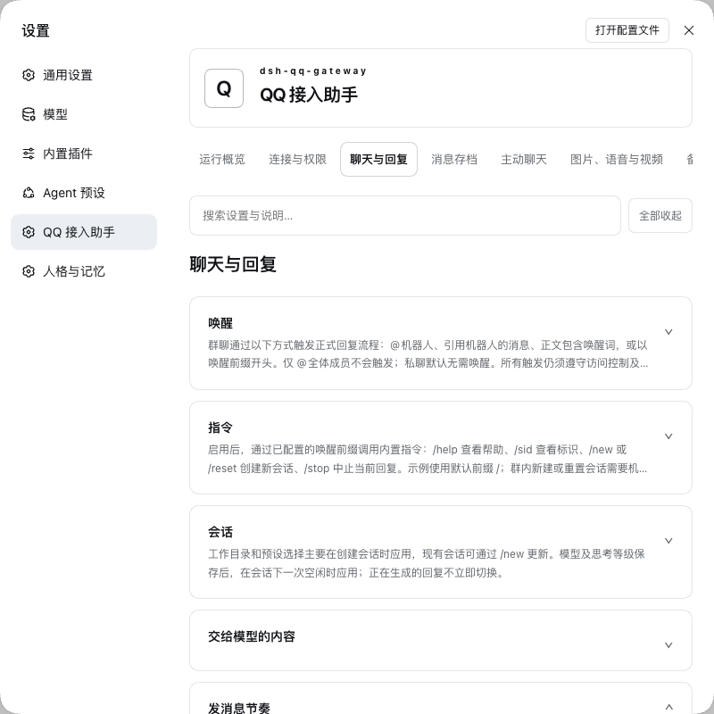

# SnowLuma Companion · 陪伴助手

将 SnowLuma 的 QQ 接入、人格与核心记忆、长期记忆、日记、主动聊天和备份整合为一个 dsh 插件。包名及仓库为 **dsh-snowluma-companion**，由原 bridge 仓库继续维护，合入 companion-core 的代码与提交历史。

## 已有 dsh：只安装插件

适用于 **dsh 0.2.1-rc.2 / Node ≥22.13** 的网页环境。先停止 dsh，再以运行 dsh 的同一系统账号、相同 `DSH_HOME` 执行（`dsh` 和 `pnpm` 须在 PATH 中）：

```sh
dsh plugin --profile web add "https://github.com/Geng-zy/dsh-snowluma-companion/releases/download/v1.4.1/dsh-snowluma-companion-1.4.1.tgz" --ignore-scripts
```

命令向现有 `web` profile 安装插件，首次安装自动加入 bundle。随后重新启动 dsh，进入 **更多 → 设置 → SnowLuma 陪伴助手**。QQ 接入需要已有 SnowLuma 及反向 WS 配置。[命令路径、其他 profile、本地安装包与升级说明](docs/PLUGIN-INSTALL.md)。

桌面版也可通过应用内插件管理安装[同一发行包](https://github.com/Geng-zy/dsh-snowluma-companion/releases/tag/v1.4.1)。从两个旧插件合并升级时，使用下方迁移流程。

## 全新服务器一键部署

支持Ubuntu22.04/24.04/26.04。可以选择[一键安装](docs/INSTALL.md)或[手动安装图文教程](docs/MANUAL-INSTALL.md)。



在服务器执行：

```sh
curl -fsSL https://raw.githubusercontent.com/Geng-zy/dsh-snowluma-companion/main/install.sh | sudo bash
```

交互填写账号、端口、主人QQ、SnowLuma/VNC密码、Token和模型配置，安装dsh、统一插件、官方SnowLuma及系统服务。结束时输出所有访问网址和凭证，并保存为私有文件；已有环境停止以免覆盖。QQ扫码由本人完成。[详细安装、续装与查看凭证](docs/INSTALL.md)。

## 安装与升级

要求 dsh **0.2.1-rc.2** 对应 SDK、Node **≥22.13**（使用内置 SQLite）。在 dsh 插件管理页安装本仓库 [v1.4.1](https://github.com/Geng-zy/dsh-snowluma-companion/releases/tag/v1.4.1) 的 `.tgz`。只需安装一个包；QQ 协议端仍由官方 SnowLuma Docker 镜像运行。

从两个旧插件升级时，停止 dsh，保留现有数据与 profile 配置，以 profile 所属用户执行：

```sh
node /解包目录/deploy/migrate-profile.mjs /绝对路径/profiles/web /绝对路径/dsh-snowluma-companion-1.4.1.tgz
cd /绝对路径/profiles/web
pnpm install
```

随后启动 dsh。迁移脚本合并 bundle 与包引用，并更新 profile 中显式的旧模块路径。内部 `snowluma-bridge`、`companion-core` 配置行继续使用原命名空间，已保存设置和凭据无需重新填写。平台 ID、QQ 会话绑定、存储目录、SQLite schema 5 和备份格式 3 保持；不要通过清空数据重新安装来合并。

## 魔搭聊天接口

自定义OpenAI Chat Completions接入魔搭时，如遇`developer is not one of...`的400错误，需要配置dsh提供商的`compat.supportsDeveloperRole: false`。此兼容设置不删除旧会话、不关闭思考或人格记忆。[原因及配置位置](docs/MODELSCOPE.md)。

## 图片生成

在“图片、语音与视频 → 图片生成”配置独立生图接口。支持OpenAI Images兼容接口、魔搭、阿里云、Google、OpenRouter、BFL、fal、Replicate、Stability、Ideogram、HF及ComfyUI/A1111；自定义HTTP和本地程序用于扩展其他官方SDK及Diffusers。默认关闭，主人可用范围与其他私聊/群聊开关独立管理。QQ直接发送图片，网页显示工具附件，设置页可试画和下载。[支持范围、配置示例、额度与验证限制](docs/IMAGE-GENERATION.md)。

## 人格编辑与生效

编辑人格后，受管会话的下一次模型请求读取最新稿；主人和公开核心记忆继续按会话权限隔离。新版显示文件来源及真实组装记录，支持Markdown导入导出、正文预览、可选HTML注释过滤和旧稿覆盖保护。[机制、使用步骤及与dsh-agent-md的对比](docs/PERSONA.md)。



## 设置入口

打开 **更多 → 设置 → SnowLuma 陪伴助手**。插件管理中的配置入口仍然可用；两处共用同一套表单和保存操作。主设置页使用横向分组导航，以适应设置面板宽度。



## 统一设置界面

设置页按用途组织，支持搜索全部设置、独立折叠、全部展开/收起、浏览器记忆展开状态，以及跨分组统一保存设置。已打开的编辑器在分组切换和收起后保留草稿；人格、核心记忆、日记正文使用编辑器内的保存按钮。

| 分组 | 内容 |
|---|---|
| 运行概览 | QQ 模块与存储状态、常用入口 |
| 连接与权限 | OneBot 连接、管理员、群/私聊白名单、会话例外规则 |
| 聊天与回复 | 唤醒、模型/预设、上下文、群上下文、分段、打字节奏、群回复 @ 与引用 |
| 人格与核心记忆 | 正文编辑、历史版本、预设生效范围、自主修改限制 |
| 记忆与存档 | 消息存档、召回、向量、关系图、记忆管理 |
| 日记与主动聊天 | 日记和月度总览、阅读、主动间隔与免打扰 |
| 图片、语音与视频 | 图片输入、STT、TTS、视频抽帧与 ffmpeg |
| 备份与迁移 | 九项备份选择、下载、预览、导入和自检 |
| 维护与通知 | 掉线通知、数据到期、记忆保养、日志 |

## 从备份恢复（可多选）

打开“备份与迁移”分组，展开独立的“恢复备份”卡片：

1. 上传本插件导出的 `.tar.gz` / `.tgz`，或选择服务器已有备份的“查看并选择恢复项目”。
2. 系统验证包的格式、路径、文件类型、大小和 SHA256，显示备份时间、数据统计及识别到的实际文件清单。
3. 勾选要恢复的类别，支持多选、全选、清空。只显示备份包含的类别，默认不勾选。
4. 确认“恢复所选项目”；系统先备份当前数据，再恢复所选内容并重新加载插件，页面显示结果。

人格、核心记忆、日记、记忆库、主人存档、主人原始会话以及三类设置均可按包内内容选择。未选类别保留当前内容；记忆库与存档共用数据库时也按所选类别恢复表，不会整库覆盖。空日记类别恢复会清空当前日记。人格和核心记忆被替换的现稿进入历史；配置密钥与 Token 不从包中覆盖。

此入口识别本插件的备份格式，也兼容旧格式 1/2；普通任意文件压缩包不能作为插件备份恢复。备份格式不变，仍为 3。

## 保留的能力与权限

- 管理员拥有最高回复权限；普通群聊和普通私聊使用独立白名单。空名单拒绝对应普通会话。主动群聊没有管理员来信豁免。
- 唤醒关键词只匹配正文，不匹配 @ 他人的昵称；支持直接 @、引用、前缀、只 @ 等待等既有规则。群回复 @ 与引用默认关闭。
- 名单外群聊的入站、出站与图片均不写入插件存档，包括管理员发言；普通名单外私聊也不存档，管理员私聊允许。
- 人格和公开/主人核心记忆、按轮数截断或第一人称压缩、长期记忆整理/召回/遗忘、向量和图关系、日记、轮换、主动聊天与 `[不发]` 保留。
- 图片、引用与嵌套转发、语音识别、双服务商语音合成、视频抽帧、本地文件/视频发送、发言节奏及掉线提醒保留。
- 普通备份九项：人格现稿、核心现稿、日记、记忆库、主人消息存档、主人 QQ 私聊原始 dsh 会话及引用附件、陪伴设置、QQ 连接与聊天设置、dsh 设置。历史备份可继续导入；不增加完整环境备份或电脑自动同步。

**存储边界**：插件存档、dsh 模型会话日志与 SnowLuma/QQ 协议缓存用途不同。插件白名单不能关闭后两者；`historySync=false` 也不关闭实时协议缓存。详见[集成边界](docs/INTEGRATION.md)。

## 部署与内部接口

[SnowLuma Compose 部署](docs/SNOWLUMA.md)。管理端口 5099/6081 发布到宿主 `0.0.0.0`，可通过服务器地址访问；公网连通还取决于安全组和防火墙；反向 WS 使用 Token。按本次用户要求，SnowLuma 内置 `#sl` 保留官方默认开启，其直接回复独立于插件白名单。

内部模块：包根入口负责 QQ 桥接，`/companion` 负责陪伴服务，`/context` 提供陪伴压缩引擎；只发布一个安装包和一个设置页。`ctx.snowluma`、`ctx.companion` 及已有事件保留，便于宿主集成。原 `/api/snowluma-bridge/*` 与 `/api/companion/*` 接口继续服务同一个包内的两个模块。

部署与官方模板的差异逐项记录在[部署差异清单](docs/DEPLOYMENT-DIFFERENCES.md)，此前额外限制及启动修复已恢复官方默认，仅保留反向 WS 和容器访问宿主的映射。

## 开发验证

```sh
scripts/setup-test-env.sh
scripts/check.sh
```

检查包含构建、统一设置脚本/词典、两部分单元测试、两套真实 dsh + 假模型/SnowLuma e2e 和隐私扫描。测试环境独立于真实 QQ；不需要真实模型 Key。

原桥接历史见 [CHANGELOG](CHANGELOG.md)，原核心历史见 [COMPANION-HISTORY](docs/COMPANION-HISTORY.md)。许可为 AGPL-3.0-or-later，移植来源见 [NOTICE](NOTICE.md)。

迁移后自检展示每个查询命中的候选记忆、编号、检索相关度与多行正文节选，保留日期标题下的内容。它用于检查检索情况，结果是记忆原文节选，并非聊天模型生成的答案；完整记录可在“记忆与存档”查看。

备份保留按所有类型合计计数：自动、手动和导入前备份共用“备份总保留份数”，默认5份。只有新备份成功生成后才删除超出数量的最早旧包，保留最新五份；失败不触发清理。
